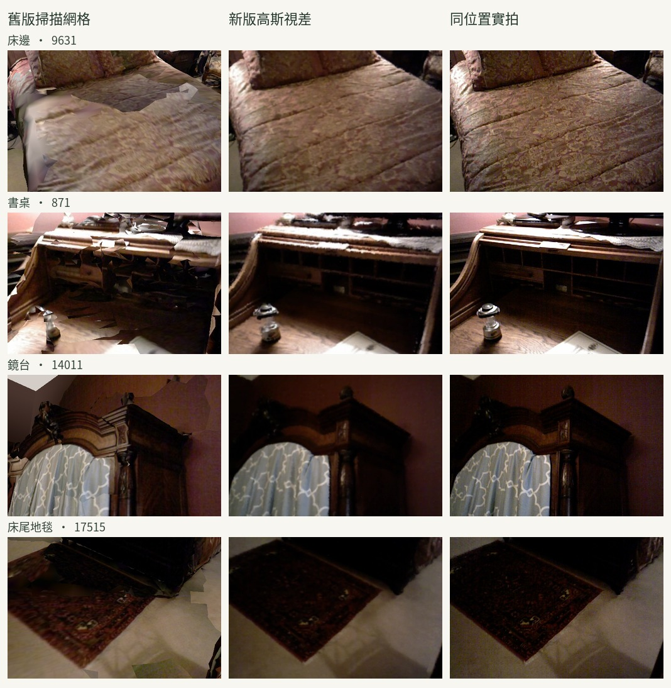

# 臥室空間重建

**[開啟全室剖視](https://clarencechien.github.io/teslarvpoc/) · [走進房間](https://clarencechien.github.io/teslarvpoc/#walk) · [平面俯視](https://clarencechien.github.io/teslarvpoc/#plan) · [下載全室 GLB](https://clarencechien.github.io/teslarvpoc/bedroom-full.glb)**


以 Redwood Bedroom 公開掃描和 601 組彩色照片、深度圖重建同一間臥室。剖視可看床、壁爐、桌椅與走道的配置。切到「全室漫遊」，用 WASD、方向鍵或畫面箭頭走動，拖曳轉頭。三個視圖使用同一個含照片貼圖的 GLB。手繪格局與原始掃描也保留在「顯示方式」供比較。[Redwood 原始資料](https://www.redwood-data.org/indoor_lidar_rgbd/)

### 全室表面與材質

先將上游重建網格對齊地板，用房間邊界補上掃描缺口，再以 Poisson 表面重建整合成 115,000 個三角面。依深度與遮蔽檢查每張照片，並優先採用較近、較正面、局部對焦較清楚的觀測。混入較廣視角的平均顏色，減輕不同曝光的接縫。下載的單一 GLB 內含 4096 × 4096 貼圖，約 7.7 MiB。在房內以同一份網格向地板和四周投射射線，取得約 10.8 平方公尺相連的可行走區域。

約 57% 的有效貼圖像素有直接照片觀測。其餘依鄰近表面的色彩補足，窗簾上緣延續下方布料，缺資料的上半牆與天花板補上推估材質。窗邊過曝、細椅腳和鏡面仍有失真。剖視會隨相機方向切開靠近觀者的牆面與屋頂，漫遊則顯示所有方向的表面。

漫遊使用 1,194 組 RGB-D，把同一段拍攝軌跡取樣得更密。瀏覽器依位置和朝向選出兩張鄰近照片，逐像素檢查深度，讓第二張補足第一張看不到的部分。站點切換時淡入，最多快取六張。獨立 GLB 與剖視仍使用由 601 組觀測製成的 4K 貼圖。[視角選擇的研究依據 · Unstructured Lumigraph Rendering](https://www.cs.princeton.edu/courses/archive/spring01/cs598b/papers/buehler01.pdf)

原照有顏色但深度失效時，先測試網格上的位置能否投回其他照片。至少兩個彼此相距超過 6 公分的相機都量到相符深度，而且顏色一致，才採用這個位置。若只有來源照片有顏色，接近原拍攝點時仍可顯示該視角，離開就淡回全室貼圖。完全沒拍到的天花板仍為推估。如果改用生成式補繪，可以得到合理外觀，但需要另行標示推測成分。[深度分層與生成補繪研究](https://openaccess.thecvf.com/content_CVPR_2020/html/Shih_3D_Photography_Using_Context-Aware_Layered_Depth_Inpainting_CVPR_2020_paper.html)

**床頭窗邊的量測。** 在靠近床頭牆 45 公分以內、高 1.4–2.83 公尺的區域，按半解析度像素取樣，總計有 348,610 筆缺少來源深度的觀測，當中 138,173 筆（39.6%）得到其他相機的深度及色彩支持。這個比例包含同一處在不同照片的重複觀測。所有角度都過曝的窗外景物仍無從辨識。

#### 漫遊畫質驗證

使用相同相機位姿渲染，與未參與貼圖及投影的 640 × 480 原照比對，四邊各裁掉 10% 計算 SSIM。各版共用上游重建幾何與相機軌跡。28 張用於比較實作，另保留 10 張，在選定發布版本後才比較結果。[38 張逐幀分數](room/walk-evaluation.csv)

| 同視角平均 SSIM | 上一版 288 個視角 | 本版 1,194 個視角 | 進步張數 |
| --- | ---: | ---: | ---: |
| 前次沿用的 16 張 | 0.557 | 0.601 | 16 / 16 |
| 另外 12 張 | 0.611 | 0.654 | 10 / 12 |
| 選定版本後驗證的 10 張 | 0.625 | 0.649 | 6 / 10 |

在前 28 張上，只使用 601 個來源、依相機位置選一張的試作平均為 0.588。換成 1,194 個來源且仍只選一張，平均為 0.608。使用兩張互補的發布版本為 0.624。低光和反光處仍可能有重影。下圖最後一列是退步例子，床罩皺褶和地面交界仍有錯位。


在 Linux Chromium 的 SwiftShader 軟體渲染環境，969 × 574 畫布暖機 2 秒後量測原地轉頭 10 秒，上一版平均 4.4 FPS，本版為 3.5 FPS（P95 畫格間隔 583.2 ms）。實體 GPU 與手機可從網頁按「測試幀率」實測。

### 其他可用的實拍資料集

選場景時要分清楚原始幀數、可用相機位姿數和真正看到新表面的角度數。Redwood Bedroom 的軌跡有 21,931 幀，原照是 640 × 480。以下數量分別註明計算單位。

| 場景 | 照片與拍攝方式 | 適合的實驗 |
| --- | --- | --- |
| Oxford Spires · Christ Church 03 | 核對官方 `raw/images.zip` 目錄，三台相機各有 6,204、6,179、6,163 張，共 **18,546 張**。官方標為室內，抽看的原圖為 1440 × 1080，可見大廳、窗戶和樓梯。 | 想看完整室內空間可先用這組。另附相機校正、軌跡與 LiDAR，魚眼照片須依校正投影。[場景檔案](https://huggingface.co/datasets/ori-drs/oxford_spires_dataset/tree/main/sequences/2024-03-18-christ-church-03) |
| Oxford Spires · Blenheim Palace 03 | 同樣依影像封存檔逐項計數，三台相機各有 13,814、13,735、13,759 張，共 **41,308 張**。這是一條涵蓋室內外的路線。 | 適合測試從戶外走入建築，以及明暗轉換。兩條 Oxford 路線均為非商業授權。[場景檔案](https://huggingface.co/datasets/ori-drs/oxford_spires_dataset/tree/main/sequences/2024-03-14-blenheim-palace-03) · [規格與授權](https://dynamic.robots.ox.ac.uk/datasets/oxford-spires/) |
| ScanNet++ | 初版論文的 460 個場景共有 28 萬張 **33 MP** 相機照片和超過 370 萬幀 iPhone RGB-D，換算每場景平均約 609 張高解析照片、超過 8,000 幀手機影像。v2 已擴至逾千個場景。 | 要還原布紋、木紋或小字優先看這組。不同感測器已配準，完整資料需向官方申請。[資料入口](https://scannetpp.mlsg.cit.tum.de/scannetpp/) · [初版統計](https://openaccess.thecvf.com/content/ICCV2023/papers/Yeshwanth_ScanNet_A_High-Fidelity_Dataset_of_3D_Indoor_Scenes_ICCV_2023_paper.pdf) |
| BundleFusion · Apt 1 | 論文附表列出**同一間公寓 8,580 幀 RGB-D**，相機軌跡長 91.8 公尺。官方提供逐幀照片、深度與位姿。 | 適合把同一套漫遊流程移到另一間真實住宅。[公寓資料](https://graphics.stanford.edu/projects/bundlefusion/) · [論文附錄表 III](https://pure.mpg.de/pubman/item/item_2351932_3/component/file_2351931/arXiv%3A1604.01093.pdf) |

### 局部實景近看

[床邊](https://clarencechien.github.io/teslarvpoc/#bed) · [書桌](https://clarencechien.github.io/teslarvpoc/#desk) · [鏡台](https://clarencechien.github.io/teslarvpoc/#mirror) · [床尾地毯](https://clarencechien.github.io/teslarvpoc/#rug)

室內近看使用四組局部高斯潑濺。在床邊、書桌、鏡台與床尾地毯位置，拖曳可左右各移 4.5 cm、上下各移 2.5 cm，雙擊或 Home 回到中心。「對照原始照片」顯示對應的完整中心影像。視角範圍之外的部分可用掃描網格環視。

### 實景近看的做法與驗證

每個位置使用 5 組 RGB-D 影像（中心及前後 12、24 幀）。以量測深度建立扁平 3D 高斯，透過相機位姿從相鄰影像補入遮蔽後方的樣本，再用深度與顏色一致性加權擬合顏色。缺少深度的位置先嘗試跨幀補點，其餘借用鄰近深度。每組約 9–10 萬個高斯。中心、尺度與透明度來自深度和取樣密度，只有顏色經多視角擬合。這個實驗的範圍是局部視角，未訓練整室自由漫遊的 3DGS。

瀏覽器預設使用「實景高斯視差」：離線將相同高斯依距離歸入 32 個逆深度層，合成帶透明度的貼圖，移動時按各層深度連續投影。也能選「逐點高斯潑濺」即時繪製同一組高斯。原照解析度為 640 × 480，放大、遮蔽邊界與反光處仍可能模糊。

每個位置保留中心前後第 6 幀，不參與局部高斯建模與舊網格貼圖。依其相機位姿各渲染 640 × 480，在每邊裁掉 10% 後量測 RGB SSIM（1 最接近原照）。兩種方法使用資料集提供的相機軌跡，舊網格採用上游完整掃描。下表是每組兩幀平均。

| 位置 | 舊掃描網格 | 新版高斯視差 |
| --- | ---: | ---: |
| 床邊 | 0.227 | 0.415 |
| 書桌 | 0.342 | 0.654 |
| 鏡台 | 0.411 | 0.719 |
| 床尾地毯 | 0.530 | 0.790 |
| 八張平均 | 0.377 | 0.644 |



在 Linux headless Chromium、SwiftShader 軟體渲染、969 × 574 畫布，床尾地毯的固定視差路徑暖機 2 秒、取樣 10 秒，分層繪製平均 33.9 FPS，P95 為 50.0 ms。每台裝置可用「測試幀率」重測目前視圖。

### 掃描網格如何製作

以 Redwood 公開的 Bedroom 多視角 RGB-D 重建網格與相機軌跡為起點。先將場景對齊地板、簡化到 86,999 個實測表面三角面，再以 301 組實拍彩色及深度影像做可見性比對。從中選取 95 個視角製作貼圖，依相鄰三角面的連續性和曝光差修整拼接。約 76% 的實測三角面有通過深度檢查的直接照片對應，其餘使用鄰近表面的顏色。窗邊過曝、鏡面、桌椅細部和織物局部仍有接縫。未掃到的牆面、地板和天花板另以推估平面封口，這些平面不代表實測細節。完整室內來自 Redwood 的臥室，舊版車庫另保留於下方。

前一版全室掃描網格實測於 Linux headless Chromium 156、SwiftShader 軟體渲染、969 × 574 畫布。固定路徑暖機 2 秒後量測 10 秒，平均 14.3 FPS，P95 畫格間隔 133.2 ms。可用頁面上的「測試幀率」在實體裝置重測。

### 在本機重現

檢視成品只需從 repo 根目錄執行 `python -m http.server 8000 --directory room/site`，在瀏覽器開啟 `http://localhost:8000/`。頁面與貼圖均由同一站台提供。

若要重新製作模型，從 Open3D 的 20220301-data 發行版本下載 bedroom01.zip 至 bedroom05.zip，解壓至同一目錄。根目錄應包含 bedroom.ply、bedroom.log，以及 image/ 和 depth/。原始網格每 73 幀取一組 RGB-D，全室貼圖每 73 幀取兩組，漫遊每 73 幀取四組，並排除留作驗證的幀。測試環境為 Python 3.12。[輸入檔案與官方校驗碼](https://github.com/isl-org/Open3D/blob/main/cpp/open3d/data/dataset/BedroomRGBDImages.cpp) · [資料封存檔](https://github.com/isl-org/open3d_downloads/releases/tag/20220301-data)

```sh
python3 -m venv .venv
. .venv/bin/activate
pip install -r room/requirements.txt
OPENBLAS_NUM_THREADS=1 python scripts/build_room.py /path/to/bedroom room/site
```

全室模型使用 Linux 的 C++17、OpenMP 與下列 Python 套件。第三個參數指定這次重建專用的空白暫存目錄，需容納至少 6 GB 中間資料。

```sh
pip install -r room/full-requirements.txt
OMP_NUM_THREADS=4 OPENBLAS_NUM_THREADS=1 python scripts/build_full_room.py /path/to/bedroom room/site /tmp/redwood-full-bake
```

若要重建格局和實景模式，在上述模型步驟後執行以下指令。格局建模使用 Blender 4.3，分層貼圖建置需要 C++17 編譯器和支援 WebP 的 Pillow。輸入資料目錄需保留各位置相鄰的彩色及深度原圖。

```sh
blender -b -P scripts/build_layout.py -- room/site
OPENBLAS_NUM_THREADS=1 python scripts/build_local_splats.py /path/to/bedroom room/site
python scripts/bake_splat_layers.py room/site
```

前端原始碼在 `room/app.js`。在 `room` 執行 `npm ci` 和 `npm run build` 可更新 `site/viewer.js`。Pages 從 `gh-pages` 根目錄發佈 `room/site/` 的靜態成品。

Jaesik Park, Qian-Yi Zhou, Vladlen Koltun. *Colored Point Cloud Registration Revisited*. ICCV 2017. Redwood 將 RGB-D 影像與重建模型釋出為公有領域並要求註明出處。[資料集與論文](https://www.redwood-data.org/indoor_lidar_rgbd/) · [使用條件](https://redwood-data.org/indoor_lidar_rgbd/license.html)

## 早期實驗 · 車庫的雙眼攝影重建

兩張實拍照片可以做出可以旋轉的 3D 表面。這個實驗用 Middlebury 的 Motorcycle 車庫場景估算深度，保留 21,061 個頂點和 38,379 個三角面。滑鼠拖曳時，前輪和後方貨架會產生不同幅度的位移。轉到側面會看見遮蔽造成的孔洞，兩張正面照片只能重建局部室內。


**[下載互動展示 viewer.html](https://github.com/clarencechien/teslarvpoc/raw/refs/heads/main/viewer.html)**，儲存後以支援 WebGL 的瀏覽器開啟。這個單檔內含幾何、照片貼圖與程式。若瀏覽器限制開啟本機檔，在 repo 目錄執行 `python -m http.server 8000`，前往 `http://localhost:8000/viewer.html`。

- 拖曳或用方向鍵轉動，滾輪或鍵盤 `+`、`-` 縮放。可切換照片、深度與點雲。
- 按「下載 3D 模型」可取得含貼圖、以公尺為單位的 glTF 2.0，能在 Blender 匯入並編輯網格。
- 按「測試幀率」會以固定路徑旋轉模型。暖機 2 秒、取樣 10 秒，顯示實際畫布解析度、平均 FPS 和第 95 百分位畫格間隔。這是前景頁面的 requestAnimationFrame 間隔，包含瀏覽器排程。全解析度的裝置像素比上限為 1.5。半解析度將寬和高各減半。

## 60 FPS 實測

固定 1280 × 800 視窗、裝置像素比 1，以 Linux headless Chromium 156 和 SwiftShader 軟體渲染執行內建測試。兩次以相同網格、貼圖和移動路徑量測，每個解析度各一次。

| 畫布像素 | 平均 FPS | P95 畫格間隔 |
| --- | ---: | ---: |
| 1176 × 512 | 31.9 | 50.1 ms |
| 588 × 256 | 33.7 | 50.1 ms |

60 FPS 的每幀預算是 16.7 ms。這台機器在兩種解析度都超過預算。硬體加速的筆電與手機仍需各自執行上方測試；整條街的效能還取決於視野中同時繪製的物件、三角面和貼圖。

## 從照片重建

測試使用 Python 3.12。從 repo 根目錄執行下列指令會重新下載有版本與 SHA-256 校驗的左右照片並產生 viewer.html。約 1.1 MB 的完成品已放在 repo。

```sh
python3 -m venv .venv
. .venv/bin/activate
pip install -r requirements.txt
python scripts/reconstruct.py
```

1. 讀取已校正到相同掃描線的左右照片，每張 741 × 500。OpenCV StereoSGBM 估算左右影像中同一點的水平位移。
2. 依已知的相機間距 0.193001 m、焦距 994.978 px 和左右主點差 31.086 px，以 `Z = focal × baseline / (disparity + doffs)` 回推公尺深度。
3. 每隔 4 像素取樣並連成網格，略過無效匹配與深度跳變，使用左相機照片貼圖。標註的參考視差僅供事後驗證。

約 91.3% 的左圖像素得到有效估計。在估計與參考視差均有效的 314,740 像素上，絕對視差誤差中位數為 0.18 px，5.8% 的像素誤差超過 2 px。金屬、輪輻和遮蔽邊緣仍可看見破面。換成手機隨拍的台灣街景時，需有同一街段的重疊視角，再用 SfM 估計相機位置，之後才能進行多視角重建。[COLMAP](https://colmap.github.io/)

## Tesla 與台灣街景工具

Musk 描述的 Reality View 會從共用視覺編碼器 UVE 取得特徵，讓獨立的約十億參數擴散模型利用上一段輸出生成新畫面。據其說明，UVE 以 18 Hz 更新，顯示端每批產生 8 幀，以 36 FPS 播放。截至 2026-11-24，在 Tesla 的公開專案中未找到這套模型的權重或推論 API。本 repo 的照片重建在離線階段完成，瀏覽器每幀只需繪製網格。[Musk 的技術說明](https://x.com/elonmusk/status/2124458557525397780) · [Tesla 官方 GitHub](https://github.com/teslamotors)

台北開發者 Jason Kuan（jason9075）的 Taipei PCG 以台北的道路層級、街廓密度與捷運周邊建築分布為原型，可以在瀏覽器調整參數並重新生成 3D 城市。作者的公開資料列出所在地為台北。目前仍缺少能將這件作品與所述 X 貼文連起來的原文。[線上展示](https://jason9075.github.io/city-pcg/) · [作品說明](https://github.com/jason9075/city-pcg) · [作者資料](https://github.com/jason9075)

## 影像來源與使用條件

兩張影像來自 Middlebury Stereo 2014 的 Motorcycle，由 scikit-image 提供縮小至四分之一的左右視圖與對應校正資料。Middlebury 允許使用與發表資料集的照片及視差圖，並請使用者引用論文。本展示由該組照片估算形狀，將左圖轉為 JPEG 貼圖。[資料及使用條件](https://vision.middlebury.edu/stereo/data/) · [原始場景](https://vision.middlebury.edu/stereo/data/scenes2014/) · [縮圖與校正參數](https://scikit-image.org/docs/stable/api/skimage.data.html#skimage.data.stereo_motorcycle)

D. Scharstein, H. Hirschmüller, Y. Kitajima, G. Krathwohl, N. Nesic, X. Wang, P. Westling. *High-Resolution Stereo Datasets with Subpixel-Accurate Ground Truth*, GCPR 2014. [論文](https://www.cs.middlebury.edu/~schar/papers/datasets-gcpr2014.pdf)
