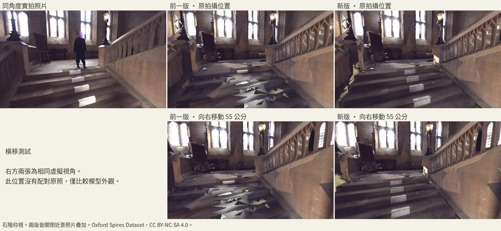
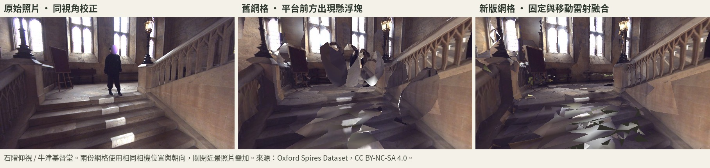
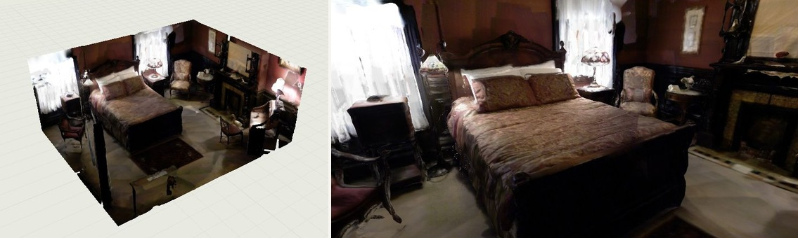
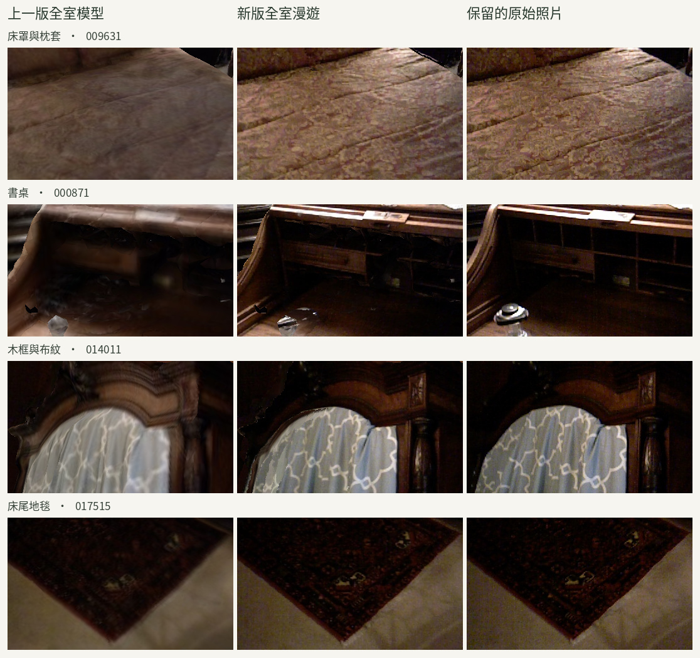
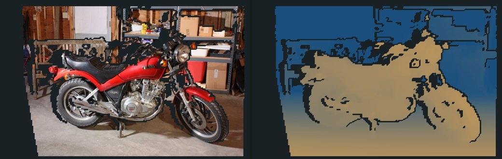

# 室內空間重建

## 牛津基督堂大廳與樓梯

**[進入 Christ Church 03](https://clarencechien.github.io/teslarvpoc/christ-church/) · [下載照片貼圖 GLB](https://clarencechien.github.io/teslarvpoc/christ-church/christ-church.glb)**

進入後拖曳環顧，用方向鍵、WASD 或觸控方向鈕在拍攝走道附近移動。五個拍攝點可直接跳到大廳或樓梯。[石階仰視](https://clarencechien.github.io/teslarvpoc/christ-church/#stairs-up) 可從下方看窗邊平台。「全區剖視」可看兩個空間如何連通。桌機可用「滑鼠自由視角」轉頭，按 Esc 結束。勾選「使用去人影、校色後的多視角實拍」可查看實拍細節。「對照原照」會打開鄰近拍攝點的原始魚眼照片，再按一次就回到剛才的位置與朝向。

### 離開拍攝點後的畫面連續性

舊版離開拍攝點約一公尺，整張實拍疊圖會逐漸退掉。走到長桌旁，可以看到桌沿碎開；轉身時，四張投影照片也可能同時換成另一組。現在從起點到走道都沿用同一套深度投影，逐像素依相機距離、遮蔽與視差調整各張照片的貢獻。近處桌椅的連續表面可以跨過掃描的小缺口；窗框、牆面與欄杆則會比對實測深度，降低拉長貼圖的影響。切換照片時會在原有四張旁預留一個位置，等新照片載好，再逐張淡入與退出。直接跳站時會等當地照片，網路讀取失敗時可先看模型，程式會重試。

[大廳與樓梯的同步行走對照](https://clarencechien.github.io/teslarvpoc/christ-church/walk-light/continuity.webp) · [行走量測](room/site/christ-church/walk-light/continuity.json) · [預留照片的逐張分數](room/christ-church-continuity-views.csv)

要在兩個已啟動的版本上重走同一段路，可執行 `python scripts/review_church_continuity.py 舊版網址 新版網址 輸出資料夾`。瀏覽器在大廳和石階各走一次，按同一組按鍵、橫移、轉頭並停步。每對行走截圖用雙向光流對齊，記錄共同可見區內灰階差超過 12/255 的像素比例，以及可供比對的畫面比例。這項量測也會受遮蔽和光流估計影響。

在 Chromium 延遲兩個素材請求，讓相機停在同一位置再放行，畫面相鄰兩幀最大的平均 RGB 色差從 3.834 降到 1.028（0–255）。大廳 26 次行走／轉頭的對齊殘差超門檻比例從 9.95% 到 8.92%，石階 21 次從 22.38% 到 20.07%。兩條路最後兩張停步截圖分別相同。

固定位置的細節仍有取捨。十個預留視角平均灰階 SSIM 從 0.8567 到 0.8499，另六個大廳斜角從 0.8619 到 0.8515。十二站檢查中，第十一站左側有一團人形殘影；自動偵測也標記了該處。使用鄰近照片重投影的額外試驗讓地面的接縫更明顯，發布版保留原有修補。測試機在 702 × 442 的 SwiftShader 軟體渲染下平均 2.2 FPS，實體 GPU 幀率尚待實測。

### 石階第二站與大廳桌沿

[直接進入石階第二站](https://clarencechien.github.io/teslarvpoc/christ-church/#landing-2) · [桌沿與地磚局部放大](https://clarencechien.github.io/teslarvpoc/christ-church/walk-light/detail-crops.webp) · [兩段漫遊前後對照](https://clarencechien.github.io/teslarvpoc/christ-church/walk-light/detail-pass.webp)

石階第二站去人後，原本鞋子的位置留下兩個深色團塊。這次先從周圍可見的石面估計平台的斜度，再把照片 200 和 1182 投回同一平面。兩張照片從不同角度看到鞋子後面的地磚。程式以拍攝時的移動雷射排除被遮住的觀測，從原照兩側的石面估計亮度，把石紋接回平台，再修正 780 個有雙視角支持的錯誤深度格。這一步使用鄰近石面估計被遮住處的光影。[地磚修補程式](scripts/church_landing_floor.py)

照片 1183 保留作複查。扣除緩慢變化的亮度後，比較它與漫遊貼圖在同一位置的石紋，在 26,888 個共同可見像素上，平均絕對灰階誤差從 10.15 降至 7.43。這個數字衡量地磚紋理與接縫。瀏覽器也依序走過全部 12 個石階站點。[量測與相機編號](room/site/christ-church/walk-light/landing-step.json)

大廳近處的深色椅背容易在橫移時裂成小三角形。在 43310f2 版走在長桌旁時，程式把已去人、校色的同一張照片鋪在由局部深度支撐的連續表面上。相機越接近家具、橫移距離越小，這張照片的細節越能保留下來。第一輪把這個做法套到整張圖，遠窗與斜角燈具出現拉伸，該版只在沿桌長觀看的近處家具使用。場景剖視和下載的 GLB 使用原本的掃描網格。[近景表面與混合程式](https://github.com/clarencechien/teslarvpoc/blob/43310f2/room/church-hall-proxy.js)

另取六個大廳實拍位置，選擇沿桌長觀看、且與鄰近投影相機有橫向偏移的位置。相機位置與朝向相同時，整張畫面的灰階 SSIM 平均從 0.8598 到 0.8619，畫面下半部從 0.8452 到 0.8496。其中兩個視角的全圖分數提高、四個略降。原來十個預留視角的平均從 0.8563 到 0.8567。近處桌沿在橫移時連續許多，斜看的細燈柱仍可能變形。[逐張分數](room/christ-church-detail-views.csv) · [瀏覽器核對程式](scripts/check_church_detail_views.py)

可從上一版重跑單一地磚修補。以下命令沿用下方列出的 Oxford 資料和 YOLOX 權重，將照片、距離圖與量測紀錄寫到新目錄。完整建置也會自動執行這一步。

```sh
git worktree add --detach /tmp/church-before-detail cf55bb5
python scripts/church_landing_floor.py /tmp/oxford-spires \
  /tmp/church-before-detail/room/site/christ-church /tmp/oxford-spires/yolox.onnx /tmp/church-floor-detail
```

### 統一窗光、移除行人與實際漫遊複查

[從窗前石階進入](https://clarencechien.github.io/teslarvpoc/christ-church/#photo-stairs) · [同一表面的光影對照圖](https://clarencechien.github.io/teslarvpoc/christ-church/walk-light/lighting-comparison.webp) · [三段實際行走的前後對照動畫](https://clarencechien.github.io/teslarvpoc/christ-church/walk-light/walk-comparison.webp)

取 257 張已標定照片，沿雷射量到的表面，找出不同時間仍看得到的同一塊石材或桌面。流程避開人像、過曝窗格與被前景擋住的像素，用 1,285 組相機配對估計每張照片的曝光與色偏。另用 257 組未參與校色的配對檢查，同一表面在兩張照片間的曝光差中位數由 0.094 降到 0.073 級，降低約 22%。若把紋理邊緣與局部暗影的差異也逐點計入，逐對取中位數後為 0.312 與 0.301 級。窗光的方向、日照亮斑與大廳的暗部取自拍攝現場。[校色與逐張去人紀錄](room/site/christ-church/walk-light/audit.json)

遇到行人時，先找其他時刻能看到背景的原照，再用雷射距離核對遮擋。人物周圍的暗影得有其他視角看到較亮的同一表面，才一併修補。整張照片修一次，再放大分區找小人影。相同的全圖與放大偵測從 81 張有反應降至 14 張；第二輪在 25 張照片接受了額外修補。另有 7 張照片修到與人物相連、且有跨視角證據的暗影。偵測數包含可能被辨識成人的壁畫或固定裝飾。桌面與手機模型各更新了 177 塊照片貼圖。漫遊依位置與方向從 202 張清理後的照片中選圖，同時最多疊四張。缺少佐證的背景會降低投影權重。大幅偏離採集路線時，仍能看到階緣破損與貼圖拉伸。原始魚眼照片可用「對照原照」查看。

第三次檢查在石階第二站找到一個人像偵測器量不到的問題。第一輪去人後，鞋子旁的地板留下了矩形補丁。程式沿原人物框檢查亮度接縫，從最多 65 個鄰近視角選取能看見背景的照片，按表面距離重新投影，再以 GrabCut 縮小到人物輪廓，用 Poisson 融合接回原地板。發布資料共有 10 張照片接受這道修補。當時放大仍能看出鞋子原先遮住處的石紋較軟。[第二站實際畫面](https://clarencechien.github.io/teslarvpoc/christ-church/walk-light/landing-comparison.webp) · [OpenCV GrabCut](https://docs.opencv.org/4.x/d8/d83/tutorial_py_grabcut.html) · [OpenCV 無縫融合](https://docs.opencv.org/4.x/df/da0/group__photo__clone.html)

驗證程式在 Chromium 實際操作大廳長桌、樓梯平台、石階實拍三段路線，各走相同的按鍵序列，逐步截取六張畫面，並檢查原照與剖視切換。動畫並排顯示相同步伐的舊版與新版。另依序停在 12 個石階拍攝點，同一人物偵測器有反應的站點從 10 處降為 0 處。這只涵蓋當下相機朝向。當時第二站腳邊仍有局部暗痕。[12 站檢查](room/site/christ-church/walk-light/stairs-check.json)[逐步畫面檢查](room/site/christ-church/walk-light/route-check.json) · [行走驗證程式](scripts/review_church_walk.py)

另用 10 張未參與貼圖、校色或漫遊投影的原照檢查相同視角，以 704 × 411 畫面扣除四周 5 像素計算灰階 SSIM。平均從 0.835 到 0.856，其中 6 個視角上升，4 個下降。含人的原照會把移除人物也計為差異。[逐張分數](room/christ-church-walk-views.csv)

校色借鑑 Brown 與 Lowe 在重疊區估計曝光增益的方法。RobustNeRF 和 NeRF On-the-go 則示範如何在遊客往來的場景辨認跨視角不一致的觀測。這個靜態網頁版採用量測深度、照片重投影與背景替換，建置時可使用 CPU。[Brown 與 Lowe](https://www.cs.ubc.ca/~lowe/papers/07brown.pdf) · [RobustNeRF](https://openaccess.thecvf.com/content/CVPR2023/html/Sabour_RobustNeRF_Ignoring_Distractors_With_Robust_Losses_CVPR_2023_paper.html) · [NeRF On-the-go](https://openaccess.thecvf.com/content/CVPR2024/html/Ren_NeRF_On-the-go_Exploiting_Uncertainty_for_Distractor-free_NeRFs_in_the_Wild_CVPR_2024_paper.html)

重跑這一版時，先依下方重建環境段落準備 Oxford 資料與 YOLOX 權重，安裝 Chromium 及 Noto Sans CJK 字型。指令會完成校色、背景修補、模型貼圖更新與瀏覽器行走檢查，最後寫入新的靜態網站目錄。現有的輸出目錄會受到保護。可用 `--chromium` 與 `--font` 指定本機路徑。

```bash
git worktree add --detach /tmp/church-before-light 2fed0e8
python -m pip install playwright==1.62.0
OPENBLAS_NUM_THREADS=1 OMP_NUM_THREADS=2 python scripts/refine_church_walk.py \
  /tmp/oxford-spires /tmp/church-before-light/room/site/christ-church \
  /tmp/oxford-spires/yolox.onnx /tmp/church-walk-cache /tmp/church-walk
```

### 全室自動清理與逐面複查

[拖曳比較清理前後、放大改動處或查看原照](https://clarencechien.github.io/teslarvpoc/christ-church/cleanup.html) · [在樓梯實際漫遊](https://clarencechien.github.io/teslarvpoc/christ-church/#stairs-up)

這輪從上一版完整的 GLB 開始，沿大廳、走道與樓梯的已標定拍攝路線搜尋。流程沿用原場景的座標和實測資料，新的清理步驟不必指定欄杆、牆面或家具的包圍盒。

1. **巡查與清除**。從 147 個位置或朝向投射視線。若兩個相隔至少 35 公分的位置都顯示能看穿某個面、沒有觀測支持該面，且三角形偏離固定式雷射點，才提出移除。
2. **局部補面**。尋找掃描顯示有表面、舊模型卻漏掉或命中遠處的區域。補片須貼近掃描點，從不同位置重投影後深度相符，且避開深度跳變。濾除孤立小片，每一批提案都會避開先前已補的位置。
3. **修正貼圖**。從可見照片取色，排除行人遮擋，取另外兩張與候選相機相隔至少 35 公分的照片檢查色差。對原先已有照片的表面，再以附近朝向相近的面檢查新貼圖是否會引入色差。
4. **逐面撤回**。另外 149 張實拍只用來檢查修改。程式用相同相機渲染提案前後，將局部結構與色差的變化記回畫面對應的三角形。至少兩個複查視角支持且有足夠像素的修改才會留下。最後再檢查兩種裝置的雷射距離和預留照片，通過才輸出新目錄。[主程式](scripts/cleanup_church.py) · [逐面複查](scripts/verify_church_edits.py) · [最終測量](scripts/review_church_cleanup.py)

桌面版提出 5,412 個三角面修改，保留 338 個刪除、204 個補面與 110 個換貼圖；手機版對自己的輕量網格保留 81、16、34 個。以 600 × 400 像素比較 12 個預留視角，桌面網格平均灰階 SSIM 從 0.7549 升至 0.7562。另取未參與逐面複查的 12 個視角，從 0.7629 升至 0.7648，其中 10 個上升。兩組都在既有拍攝路線附近。以移動式雷射核對，桌面大廳內提早超過 30 公分擋住的射線從 18,893 降至 18,629；樓梯區完全沒有交點的射線從 1,676 增至 1,698。大型遮蔽區仍可能缺面。[修改計數](room/site/christ-church/cleanup.json) · [完整驗證資料](room/site/christ-church/cleanup-review.json)

COLMAP 有以可見性移除遮擋已知空處之網格面的做法，CGAL 能沿網格開口的邊界自動三角化；單靠邊界形狀無法區別掃描裂縫和拱門。這裡用已量到的深度決定是否補面。貼圖複查也參考 Waechter 等人對遮擋、曝光差異與貼圖接縫的分析。本流程使用 Open3D、OpenCV 和上述逐面規則。[COLMAP 文件](https://colmap.github.io/faq.html) · [CGAL 補洞文件](https://doc.cgal.org/latest/PMP_Mesh_repair/index.html) · [Let There Be Color!](https://download.mmag.hrz.tu-darmstadt.de/media/FB20/GCC/paper/Waechter-2014-LTB.pdf)

重跑已發布的測試可從修補前的版本取回兩個模型與原始可見性圖。下方重建環境段落列有 Oxford 資料與行人偵測權重的下載方式。可把目前場景或指定的歷史版本當作輸入，每次寫入新的輸出目錄。比較圖預設使用 Noto Sans CJK，可用 `--font` 指定相容的字型集。

```bash
git worktree add --detach /tmp/church-before-cleanup fe4559b
OPENBLAS_NUM_THREADS=1 OMP_NUM_THREADS=3 python scripts/cleanup_church.py \
  /tmp/oxford-spires /tmp/church-before-cleanup/room/site/christ-church \
  /tmp/church-cleaned /tmp/oxford-spires/yolox.onnx
```

### 樓梯欄杆局部修補

[從欄杆側視開始](https://clarencechien.github.io/teslarvpoc/christ-church/#rail-repair) · [看雷射剖面、修補前後與橫移對照](https://clarencechien.github.io/teslarvpoc/christ-church/rail-repair.webp)

舊模型的側面有些看似完整的欄孔，其實是照片畫在一片連續三角面上。橫向移動時，孔後方的窗戶便會跟著石材移動。新版先從固定式雷射的側面剖面選定三段欄杆及下緣，保留下方的連續石板。範圍內的柱身、扶手和拱形開口由程式重建。它在 1.6 公分格網上估計表面距離，以 Marching Cubes 擷取表面，濾除遠離掃描點的面與孤立碎片，再從 67 張已標定照片中為每個可見位置選取最多三張上色。缺少直接照片的貼圖像素由鄰近、朝向相近的表面取色。桌面和手機的 GLB 都含有修補後的網格與貼圖。[修補程式](scripts/church_rail_repair.py)

以移動式雷射複核，71,789 條實測穿過欄杆範圍的射線中，桌面模型提早擋住的數量從 2,964 降到 667，手機從 2,384 降到 562。在 63,023 條打中局部表面的射線上，桌面的距離誤差中位數從 2.85 降到 2.25 公分。代價是整個樓梯區 324,505 條射線中，桌面完全沒碰到模型的從 1,570 增到 1,676。細欄柱邊緣仍有鋸齒，其他牆角仍可見舊模型的裂面。[量測結果](room/christ-church-rail-audit.csv) · [檢查程式](scripts/audit_church_rails.py)

另以 5 個未參與照片投影的相機位置檢查外觀。相同瀏覽器視角的平均灰階 SSIM 從 0.832 升到 0.843。關閉近景投影，對第 198 幀的正面石階原照，網格貼圖的 SSIM 從 0.630 升到 0.660。橫移 55 公分的對照圖只用來比較兩個模型，該位置沒有配對照片。[瀏覽器逐張數據](room/christ-church-photowalk.csv)

### 石階實拍路線

[從第一個實拍位置開始](https://clarencechien.github.io/teslarvpoc/christ-church/#photo-stairs) · [直接看留出照片位置的合成視角](https://clarencechien.github.io/teslarvpoc/christ-church/#stairs-up) · [看同角度與橫移對照](https://clarencechien.github.io/teslarvpoc/christ-church/photo-walk-comparison.webp)

用拍攝點旁的左右箭頭走過 12 個真實相機位置。第一站可以看到前方平台和石階上的窗光。到站後在原相機的視野內依鏡頭標定顯示去人影、校色後的照片；拖曳可環顧，用 WASD、方向鍵或右下角按鈕可自由離開路線。相機中心以外，近景照片依雷射距離補償視差，隨距離逐步切換為多視角合成。關閉「疊加近景實拍」可檢查底層網格。

初版樓梯有 67 組已標定的位置與方向。當時的瀏覽器依觀看位置和朝向選取最多四張照片，從固定雷射點生成的深度格網補充原網格缺少的表面，在深度斷層處斷開三角形。以量測距離、照片邊緣、視差及多張照片的色彩一致性加權。離線使用 YOLOX 將偵測到的行人區域從跨視角投影中排除，當時停在實拍點仍會看到入鏡的人。人物邊緣、細欄杆和被遮住的背景仍可能留有淡影或缺口。[重建程式](scripts/build_church_photowalk.py) · [OpenCV Zoo 人物偵測模型](https://huggingface.co/opencv/object_detection_yolox)

在欄杆修補前，以相同瀏覽器視角比對 5 張未用於投影的照片（含另外兩台相機）。灰階 SSIM 平均從單張近照投影的 0.797 提高到 0.832。以石階仰視第 198 幀為例，遊戲重繪為 0.514、單張投影為 0.707、多視角合成為 0.755。畫面為 758 × 456，計分時去除外圈 5 像素。這組結果衡量照片外觀，涵蓋同一採集路線附近的視角。[逐張數據](room/christ-church-photowalk.csv)

### 石階遊戲重繪

[進入遊戲版石階](https://clarencechien.github.io/teslarvpoc/christ-church/#game-stairs) · [同視角實拍、實測網格與遊戲重繪](https://clarencechien.github.io/teslarvpoc/christ-church/game-comparison.webp)

用方向鍵、WASD 或觸控方向鈕走過兩段石階與共用平台。在石階區按「室內漫遊」或「遊戲重繪」可從目前位置切換兩種畫面，「對照原照」可查看鄰近相機的實拍。從上方連結進入只會載入遊戲場景，切換實測版時才下載完整掃描模型。

兩段樓梯沿用雷射擬合的 11 與 14 個高度落差。三面牆和拱頂用測繪點估計表面起伏，再混合可見實拍的色彩。後方窗框、欄杆、燈具、長椅和南側收邊由程式建立；形狀和光源方向含美術推定。程序將生成的石灰岩紋理固定在模型表面，Three.js 即時繪製光照、窗格投光與陰影。這個展示可檢查橫移時的空間連續性，細部裝飾與日照位置不能作為現場量測。Tesla 描述的 Reality View 則透過視覺特徵和前一段畫面生成下一段影片。[Musk 對 Reality View 的說明](https://x.com/elonmusk/status/2124458557525397780)

### 石階仰視與橫移對照

石階上被陽光照亮的白斑，前一版會碎成許多三角形。這一版先沿兩段樓梯的固定式雷射剖面找出 11 和 14 個高度落差，再用橫跨階寬的量測點擬合每一級的前緣和坡度。每個踏面和立面各使用一張連續貼圖，每個像素取自可見的實拍照片，避開被前景擋住的觀測，並降低色差特別大的觀測權重。照片看不到的位置取固定掃描點的顏色。此修正涵蓋兩段樓梯，欄杆接縫、平台和牆角仍可見局部缺口。[從石階仰視位置進入](https://clarencechien.github.io/teslarvpoc/christ-church/#stairs-up)



關閉近景照片疊加，取未參與踏面貼圖的前相機第 198 幀，把原照校正到與漫遊入口相同的視角。570 × 335 全畫面灰階 SSIM 從 0.591 提高到 0.630，樓梯所占的畫面下半部從 0.605 提高到 0.686。向右橫移 55 公分後仍可見連續踏面，該位置無配對照片。另以 12 張預留照片測整體外觀，本版平均為 0.734，開啟疊加後為 0.785。[比較圖產生程式](scripts/compare_church_stairs.py) · [逐張外觀數據](room/christ-church-evaluation.csv)

桌面版沿樓梯區 324,505 條有效雷射光線檢查，落在量測距離 12 公分內的比例從 88.15% 到 88.17%。無交點從 0.60% 降到 0.48%，但比量測晚 30 公分以上才碰到模型的光線從 4.98% 增到 5.41%。這一輪主要改善踏面的視覺連續性。踏面修補完成時的網格為桌面 404,353 個、手機 178,057 個三角面。[逐幀距離數據](room/christ-church-geometry.csv)

### 前一輪修正：石階上的懸浮塊

在石階下方仰視，舊版會在窗前顯示不規則的塊體，關閉實拍細節疊加仍看得見。對應的原照可見一人站在平台上，另一些拍攝位置也有人經過。舊流程將不同時間的移動雷射點一起做 Poisson 重建，只檢查網格與最近掃描點的距離。這會保留暫態點，也可能在稀疏的點之間補出表面。特定碎塊的原物無法逐塊辨認。舊版的 SSIM 評估照片外觀，無法驗證空中是否真的有表面。



前一輪用 Oxford 官方的固定式地面雷射測繪圖決定靜態表面。用 239 組同步位姿做剛體對齊，配對位置殘差的中位數 1.5 公分、P95 2.9 公分。這是軌跡對齊的殘差。將測繪點從走道上的 79 個位置投成六方向深度圖，以 4.6 公分體素做 TSDF 融合。簡化前後檢查三角面的頂點與中心，距固定掃描超過 13.5 公分的面會被移除。移動掃描的候選面須有跨位置重複命中，或同時貼近獨立的固定式測繪，並通過空間穿透檢查；用它們補回固定式掃描看不全的踏面。最後在仍有缺口的區域加入貼近固定測繪點的局部 Poisson 補面。將實拍照片投回網格時，同時檢查三角形邊界與拍攝當時的移動雷射遮蔽，有量到近處遮擋的位置會拒用背景投影。缺乏整面照片的位置，優先用至多五張可見實拍的逐點中位色，仍缺資料時使用固定掃描的色彩。[固定式掃描來源](https://huggingface.co/datasets/ori-drs/oxford_spires_dataset/tree/main/ground_truth_map/christ-church)

| 區域與桌面版本 | 有效雷射光線 | 過早碰撞 >30 cm | 過晚碰撞 >30 cm | 沒有交點 | 距離誤差 ≤12 cm |
|---|---:|---:|---:|---:|---:|
| 樓梯舊版 | 324,505 | 10.95% | 2.81% | 0.03% | 83.67% |
| 樓梯固定測繪版 | 324,505 | 2.38% | 4.98% | 0.60% | 88.15% |
| 大廳舊版 | 355,400 | 9.89% | 2.52% | 0.00% | 81.81% |
| 大廳固定測繪版 | 355,400 | 5.32% | 4.76% | 0.74% | 81.97% |

每條光線從相機沿著有效量測像素發出，對照 GLB 的第一個交點與資料集提供的雷射距離。測試取前相機、完全同時間戳且原始距離在 0.6–22 公尺之間的資料。樓梯使用前相機第 174–209 幀，大廳使用第 18–75 幀，範圍均含兩端。每條光線各計一次，同一物體可能被多次量到。公開深度影像與移動點雲來自同一感測器，這是量測一致性檢查。固定測繪和移動拍攝時間不同，原照中的人物可能造成量測差異。[逐幀距離數據](room/christ-church-geometry.csv)

前一輪的桌面網格有 408,454 個三角面，79.73% 的三角面通過貼圖檢查。另以 12 張未用於貼圖或細節投影的照片比較外觀，400 × 300 全畫面灰階 SSIM 平均為 0.732，加入鄰近實拍後為 0.782。同一批照片在舊版加入近景投影後平均為 0.766。樓梯近景改用更密的拍攝視角，Pages 現在按需從 162 個位置與方向選圖。當時的手機版保留 180,000 個三角面以減少簡化時的破面。

### 進一步提高仿真度

Oxford Spires 作者在另外一次採集的影像上測試時，Splatfacto 的跨序列表現比 Nerfacto 差，說明留出不同拍攝路線比隨機抽出相鄰照片更能檢查泛化能力。[原資料集實驗與 Table 5](https://journals.sagepub.com/doi/full/10.1177/02783649251369905)

值得先在樓梯平台做小範圍 A/B。保留經雷射驗證的表面與碰撞，另外訓練會隨觀察方向改變顏色的高斯外觀。比較窗框、石材高光、欄杆在橫移時是否穩定。這是後續實驗建議，目前 Pages 使用照片貼圖與近景投影。

| 本場景的問題 | 研究可用的做法 | 驗收方式 |
|---|---|---|
| 石牆、高窗在斜視時紋理會拉長 | 3DGUT 支援魚眼和其他非線性相機，可直接利用完整魚眼畫面訓練。將它與雷射深度約束整合是本場景的實驗設計。[CVPR 2025 論文與程式](https://research.nvidia.com/labs/toronto-ai/3DGUT/) | 預留整段行走路徑的三台相機，同一閾值檢查雷射距離，再比較靜態區域 LPIPS、SSIM 和橫移錄影。 |
| 照片中有人走過、不同時間曝光不同 | WildGaussians 學習降低暫態遮擋的影響，另外建模外觀變化。2026 年的室內研究也直接比較幾何與動態感知的高斯重建。[WildGaussians](https://wild-gaussians.github.io/) · [室內動態感知研究](https://doi.org/10.1145/3744256.3812573) | 用有人和無人的原照檢查同一處，確認人物離開後，背景石階在另一個位置也能對上。 |
| 新視角看起來逼真，但空間中可能出現漂浮顆粒 | 以 LiDAR 提供的表面位置與方向限制高斯的位置及形狀。2026 年已有直接用 LiDAR 監督、將高斯對齊表面的研究。[研究論文](https://www.sciencedirect.com/science/article/abs/pii/S0141938226000120) | 同時記錄過早碰撞、漏面、深度誤差，以及高斯畫面自身的透明度累積深度，避免碰撞網格通過而畫面仍漂浮。 |
| 手機載入量與幀時間 | 訓練可離線完成，GitHub Pages 發布壓縮的 SOG 與不同細節層級；瀏覽器可依觀看位置和預算載入。[PlayCanvas 分區串流文件](https://developer.playcanvas.com/user-manual/gaussian-splatting/building/unified-rendering/lod-streaming/) | 比較同台手機、同一條路徑的首畫面時間、下載量和 P95 幀時間；60 FPS 的單幀預算約 16.7 ms。 |

### 重建牛津場景

將下列指令的工作目錄設在 repo 根目錄。影像、深度和模型衍生素材沿用 Oxford Spires Dataset 的 CC BY-NC-SA 4.0 授權。作者為 Yifu Tao、Miguel Ángel Muñoz-Bañón、Lintong Zhang、Jiahao Wang、Lanke Frank Tarimo Fu 與 Maurice Fallon。[資料集](https://dynamic.robots.ox.ac.uk/datasets/oxford-spires/) · [場景檔案](https://huggingface.co/datasets/ori-drs/oxford_spires_dataset/tree/main/sequences/2024-03-18-christ-church-03) · [授權](https://creativecommons.org/licenses/by-nc-sa/4.0/)

```sh
dataset=https://huggingface.co/datasets/ori-drs/oxford_spires_dataset/resolve/03f4382308333aa70c3253f12acd3fbf0c7c4a15
base=$dataset/sequences/2024-03-18-christ-church-03/processed
mkdir -p /tmp/oxford-spires
for asset in colmap/images.zip colmap/transforms_colmap_scaled.json vilens-slam/undist-clouds.zip trajectory/gt-tum.txt lidar-depths/depths_euc.zip; do
  curl --fail --location --retry 3 "$base/$asset" -o "/tmp/oxford-spires/$(basename "$asset")"
done
curl --fail --location --retry 3 "$dataset/ground_truth_map/christ-church/merged-cloud-1cm.pcd" -o /tmp/oxford-spires/merged-cloud-1cm.pcd
python -m pip install -r room/full-requirements.txt scikit-image==0.25.2
OPENBLAS_NUM_THREADS=1 OMP_NUM_THREADS=4 python scripts/build_christ_church.py /tmp/oxford-spires room/site/christ-church /tmp/oxford-spires/cache
OPENBLAS_NUM_THREADS=1 OMP_NUM_THREADS=4 python scripts/build_church_game.py /tmp/oxford-spires room/site/christ-church
curl --fail --location 'https://huggingface.co/opencv/object_detection_yolox/resolve/78c368f74ce73ee28fc7a1be418a598c71b58b52/object_detection_yolox_2022nov.onnx' -o /tmp/oxford-spires/yolox.onnx
OPENBLAS_NUM_THREADS=1 OMP_NUM_THREADS=4 python scripts/build_church_photowalk.py /tmp/oxford-spires room/site/christ-church /tmp/oxford-spires/yolox.onnx
mkdir -p /tmp/oxford-spires/before-rails
cp room/site/christ-church/christ-church{,-mobile}.glb /tmp/oxford-spires/before-rails/
OPENBLAS_NUM_THREADS=1 OMP_NUM_THREADS=4 python scripts/church_rail_repair.py /tmp/oxford-spires room/site/christ-church /tmp/oxford-spires/cache
python scripts/audit_church_rails.py /tmp/oxford-spires /tmp/oxford-spires/before-rails room/site/christ-church /tmp/current-rail-audit.csv
python scripts/evaluate_christ_church.py /tmp/oxford-spires room/site/christ-church /tmp/current-appearance.csv
python scripts/audit_church_geometry.py /tmp/oxford-spires /tmp/current-depth.csv room/site/christ-church/christ-church{,-mobile}.glb
(cd room && npm ci && npm run build)
```

## Redwood 臥室

**[開啟全室剖視](https://clarencechien.github.io/teslarvpoc/) · [走進房間](https://clarencechien.github.io/teslarvpoc/#walk) · [平面俯視](https://clarencechien.github.io/teslarvpoc/#plan) · [下載全室 GLB](https://clarencechien.github.io/teslarvpoc/bedroom-full.glb)**



以 Redwood Bedroom 公開掃描和 601 組彩色照片、深度圖重建同一間臥室。剖視可看床、壁爐、桌椅與走道的配置。切到「全室漫遊」，用 WASD、方向鍵或畫面箭頭走動，拖曳轉頭。三個視圖使用同一個含照片貼圖的 GLB。手繪格局與原始掃描也保留在「顯示方式」供比較。[Redwood 原始資料](https://www.redwood-data.org/indoor_lidar_rgbd/)

### 全室表面與材質

先將上游重建網格對齊地板，用房間邊界補上掃描缺口，再以 Poisson 表面重建整合成 115,000 個三角面。依深度與遮蔽檢查每張照片，並優先採用較近、較正面、局部對焦較清楚的觀測。混入較廣視角的平均顏色，減輕不同曝光的接縫。下載的單一 GLB 內含 4096 × 4096 貼圖，約 7.7 MiB。在房內以同一份網格向地板和四周投射射線，取得約 10.8 平方公尺相連的可行走區域。

約 57% 的有效貼圖像素有直接照片觀測。其餘依鄰近表面的色彩補足，窗簾上緣延續下方布料，缺資料的上半牆與天花板補上推估材質。窗邊過曝、細椅腳和鏡面仍有失真。剖視會隨相機方向切開靠近觀者的牆面與屋頂，漫遊則顯示所有方向的表面。

漫遊使用 1,194 組 RGB-D，把同一段拍攝軌跡取樣得更密。瀏覽器依位置和朝向選出兩張鄰近照片，逐像素檢查深度，讓第二張補足第一張看不到的部分。站點切換時淡入，最多快取六張。獨立 GLB 與剖視仍使用由 601 組觀測製成的 4K 貼圖。[視角選擇的研究依據 · Unstructured Lumigraph Rendering](https://www.cs.princeton.edu/courses/archive/spring01/cs598b/papers/buehler01.pdf)

原照有顏色但深度失效時，先測試網格上的位置能否投回其他照片。至少兩個彼此相距超過 6 公分的相機都量到相符深度，而且顏色一致，才採用這個位置。若只有來源照片有顏色，接近原拍攝點時仍可顯示該視角，離開就淡回全室貼圖。完全沒拍到的天花板仍為推估。如果改用生成式補繪，可以得到合理外觀，但需要另行標示推測成分。[深度分層與生成補繪研究](https://openaccess.thecvf.com/content_CVPR_2020/html/Shih_3D_Photography_Using_Context-Aware_Layered_Depth_Inpainting_CVPR_2020_paper.html)

**床頭窗邊的量測。** 在靠近床頭牆 45 公分以內、高 1.4–2.83 公尺的區域，按半解析度像素取樣，總計有 348,610 筆缺少來源深度的觀測，當中 138,173 筆（39.6%）得到其他相機的深度及色彩支持。這個比例包含同一處在不同照片的重複觀測。所有角度都過曝的窗外景物仍無從辨識。

#### 漫遊畫質驗證

使用相同相機位姿渲染，與未參與貼圖及投影的 640 × 480 原照比對，四邊各裁掉 10% 計算 SSIM。各版共用上游重建幾何與相機軌跡。28 張用於比較實作，另保留 10 張，在選定發布版本後才比較結果。[38 張逐幀分數](room/walk-evaluation.csv)

| 同視角平均 SSIM | 上一版 288 個視角 | 本版 1,194 個視角 | 進步張數 |
| --- | ---: | ---: | ---: |
| 前次沿用的 16 張 | 0.557 | 0.601 | 16 / 16 |
| 另外 12 張 | 0.611 | 0.654 | 10 / 12 |
| 選定版本後驗證的 10 張 | 0.625 | 0.649 | 6 / 10 |

在前 28 張上，只使用 601 個來源、依相機位置選一張的試作平均為 0.588。換成 1,194 個來源且仍只選一張，平均為 0.608。使用兩張互補的發布版本為 0.624。低光和反光處仍可能有重影。下圖最後一列是退步例子，床罩皺褶和地面交界仍有錯位。



在 Linux Chromium 的 SwiftShader 軟體渲染環境，969 × 574 畫布暖機 2 秒後量測原地轉頭 10 秒，上一版平均 4.4 FPS，本版為 3.5 FPS（P95 畫格間隔 583.2 ms）。實體 GPU 與手機可從網頁按「測試幀率」實測。

### 其他可用的實拍資料集

選場景時要分清楚原始幀數、可用相機位姿數和真正看到新表面的角度數。Redwood Bedroom 的軌跡有 21,931 幀，原照是 640 × 480。以下數量分別註明計算單位。

| 場景 | 照片與拍攝方式 | 適合的實驗 |
| --- | --- | --- |
| Oxford Spires · Christ Church 03 | 核對官方 `raw/images.zip` 目錄，三台相機各有 6,204、6,179、6,163 張，共 **18,546 張**。官方標為室內，抽看的原圖為 1440 × 1080，可見大廳、窗戶和樓梯。 | 想看完整室內空間可先用這組。另附相機校正、軌跡與 LiDAR，魚眼照片須依校正投影。[場景檔案](https://huggingface.co/datasets/ori-drs/oxford_spires_dataset/tree/main/sequences/2024-03-18-christ-church-03) |
| Oxford Spires · Blenheim Palace 03 | 同樣依影像封存檔逐項計數，三台相機各有 13,814、13,735、13,759 張，共 **41,308 張**。這是一條涵蓋室內外的路線。 | 適合測試從戶外走入建築，以及明暗轉換。兩條 Oxford 路線均為非商業授權。[場景檔案](https://huggingface.co/datasets/ori-drs/oxford_spires_dataset/tree/main/sequences/2024-03-14-blenheim-palace-03) · [規格與授權](https://dynamic.robots.ox.ac.uk/datasets/oxford-spires/) |
| ScanNet++ | 初版論文的 460 個場景共有 28 萬張 **33 MP** 相機照片和超過 370 萬幀 iPhone RGB-D，換算每場景平均約 609 張高解析照片、超過 8,000 幀手機影像。v2 已擴至逾千個場景。 | 要還原布紋、木紋或小字優先看這組。不同感測器已配準，完整資料需向官方申請。[資料入口](https://scannetpp.mlsg.cit.tum.de/scannetpp/) · [初版統計](https://openaccess.thecvf.com/content/ICCV2023/papers/Yeshwanth_ScanNet_A_High-Fidelity_Dataset_of_3D_Indoor_Scenes_ICCV_2023_paper.pdf) |
| BundleFusion · Apt 1 | 論文附表列出**同一間公寓 8,580 幀 RGB-D**，相機軌跡長 91.8 公尺。官方提供逐幀照片、深度與位姿。 | 適合把同一套漫遊流程移到另一間真實住宅。[公寓資料](https://graphics.stanford.edu/projects/bundlefusion/) · [論文附錄表 III](https://pure.mpg.de/pubman/item/item_2351932_3/component/file_2351931/arXiv%3A1604.01093.pdf) |

### 局部實景近看

[床邊](https://clarencechien.github.io/teslarvpoc/#bed) · [書桌](https://clarencechien.github.io/teslarvpoc/#desk) · [鏡台](https://clarencechien.github.io/teslarvpoc/#mirror) · [床尾地毯](https://clarencechien.github.io/teslarvpoc/#rug)

室內近看使用四組局部高斯潑濺。在床邊、書桌、鏡台與床尾地毯位置，拖曳可左右各移 4.5 cm、上下各移 2.5 cm，雙擊或 Home 回到中心。「對照原始照片」顯示對應的完整中心影像。視角範圍之外的部分可用掃描網格環視。

### 實景近看的做法與驗證

每個位置使用 5 組 RGB-D 影像（中心及前後 12、24 幀）。以量測深度建立扁平 3D 高斯，透過相機位姿從相鄰影像補入遮蔽後方的樣本，再用深度與顏色一致性加權擬合顏色。缺少深度的位置先嘗試跨幀補點，其餘借用鄰近深度。每組約 9–10 萬個高斯。中心、尺度與透明度來自深度和取樣密度，只有顏色經多視角擬合。這個實驗的範圍是局部視角，未訓練整室自由漫遊的 3DGS。

瀏覽器預設使用「實景高斯視差」：離線將相同高斯依距離歸入 32 個逆深度層，合成帶透明度的貼圖，移動時按各層深度連續投影。也能選「逐點高斯潑濺」即時繪製同一組高斯。原照解析度為 640 × 480，放大、遮蔽邊界與反光處仍可能模糊。

每個位置保留中心前後第 6 幀，不參與局部高斯建模與舊網格貼圖。依其相機位姿各渲染 640 × 480，在每邊裁掉 10% 後量測 RGB SSIM（1 最接近原照）。兩種方法使用資料集提供的相機軌跡，舊網格採用上游完整掃描。下表是每組兩幀平均。

| 位置 | 舊掃描網格 | 新版高斯視差 |
| --- | ---: | ---: |
| 床邊 | 0.227 | 0.415 |
| 書桌 | 0.342 | 0.654 |
| 鏡台 | 0.411 | 0.719 |
| 床尾地毯 | 0.530 | 0.790 |
| 八張平均 | 0.377 | 0.644 |


在 Linux headless Chromium、SwiftShader 軟體渲染、969 × 574 畫布，床尾地毯的固定視差路徑暖機 2 秒、取樣 10 秒，分層繪製平均 33.9 FPS，P95 為 50.0 ms。每台裝置可用「測試幀率」重測目前視圖。

### 掃描網格如何製作

以 Redwood 公開的 Bedroom 多視角 RGB-D 重建網格與相機軌跡為起點。先將場景對齊地板、簡化到 86,999 個實測表面三角面，再以 301 組實拍彩色及深度影像做可見性比對。從中選取 95 個視角製作貼圖，依相鄰三角面的連續性和曝光差修整拼接。約 76% 的實測三角面有通過深度檢查的直接照片對應，其餘使用鄰近表面的顏色。窗邊過曝、鏡面、桌椅細部和織物局部仍有接縫。未掃到的牆面、地板和天花板另以推估平面封口，這些平面不代表實測細節。完整室內來自 Redwood 的臥室，舊版車庫另保留於下方。

前一版全室掃描網格實測於 Linux headless Chromium 156、SwiftShader 軟體渲染、969 × 574 畫布。固定路徑暖機 2 秒後量測 10 秒，平均 14.3 FPS，P95 畫格間隔 133.2 ms。可用頁面上的「測試幀率」在實體裝置重測。

### 在本機重現

檢視成品只需從 repo 根目錄執行 `python -m http.server 8000 --directory room/site`，在瀏覽器開啟 `http://localhost:8000/`。頁面與貼圖均由同一站台提供。

若要重新製作模型，從 Open3D 的 20220301-data 發行版本下載 bedroom01.zip 至 bedroom05.zip，解壓至同一目錄。根目錄應包含 bedroom.ply、bedroom.log，以及 image/ 和 depth/。原始網格每 73 幀取一組 RGB-D，全室貼圖每 73 幀取兩組，漫遊每 73 幀取四組，並排除留作驗證的幀。測試環境為 Python 3.12。[輸入檔案與官方校驗碼](https://github.com/isl-org/Open3D/blob/main/cpp/open3d/data/dataset/BedroomRGBDImages.cpp) · [資料封存檔](https://github.com/isl-org/open3d_downloads/releases/tag/20220301-data)

```sh
python3 -m venv .venv
. .venv/bin/activate
pip install -r room/requirements.txt
OPENBLAS_NUM_THREADS=1 python scripts/build_room.py /path/to/bedroom room/site
```

全室模型使用 Linux 的 C++17、OpenMP 與下列 Python 套件。第三個參數指定這次重建專用的空白暫存目錄，需容納至少 6 GB 中間資料。

```sh
pip install -r room/full-requirements.txt
OMP_NUM_THREADS=4 OPENBLAS_NUM_THREADS=1 python scripts/build_full_room.py /path/to/bedroom room/site /tmp/redwood-full-bake
```

若要重建格局和實景模式，在上述模型步驟後執行以下指令。格局建模使用 Blender 4.3，分層貼圖建置需要 C++17 編譯器和支援 WebP 的 Pillow。輸入資料目錄需保留各位置相鄰的彩色及深度原圖。

```sh
blender -b -P scripts/build_layout.py -- room/site
OPENBLAS_NUM_THREADS=1 python scripts/build_local_splats.py /path/to/bedroom room/site
python scripts/bake_splat_layers.py room/site
```

前端原始碼在 `room/app.js`。在 `room` 執行 `npm ci` 和 `npm run build` 可更新 `site/viewer.js`。Pages 從 `gh-pages` 根目錄發佈 `room/site/` 的靜態成品。

Jaesik Park, Qian-Yi Zhou, Vladlen Koltun. *Colored Point Cloud Registration Revisited*. ICCV 2017. Redwood 將 RGB-D 影像與重建模型釋出為公有領域並要求註明出處。[資料集與論文](https://www.redwood-data.org/indoor_lidar_rgbd/) · [使用條件](https://redwood-data.org/indoor_lidar_rgbd/license.html)

## 早期實驗 · 車庫的雙眼攝影重建

兩張實拍照片可以做出可以旋轉的 3D 表面。這個實驗用 Middlebury 的 Motorcycle 車庫場景估算深度，保留 21,061 個頂點和 38,379 個三角面。滑鼠拖曳時，前輪和後方貨架會產生不同幅度的位移。轉到側面會看見遮蔽造成的孔洞，兩張正面照片只能重建局部室內。



**[下載互動展示 viewer.html](https://github.com/clarencechien/teslarvpoc/raw/refs/heads/main/viewer.html)**，儲存後以支援 WebGL 的瀏覽器開啟。這個單檔內含幾何、照片貼圖與程式。若瀏覽器限制開啟本機檔，在 repo 目錄執行 `python -m http.server 8000`，前往 `http://localhost:8000/viewer.html`。

- 拖曳或用方向鍵轉動，滾輪或鍵盤 `+`、`-` 縮放。可切換照片、深度與點雲。
- 按「下載 3D 模型」可取得含貼圖、以公尺為單位的 glTF 2.0，能在 Blender 匯入並編輯網格。
- 按「測試幀率」會以固定路徑旋轉模型。暖機 2 秒、取樣 10 秒，顯示實際畫布解析度、平均 FPS 和第 95 百分位畫格間隔。這是前景頁面的 requestAnimationFrame 間隔，包含瀏覽器排程。全解析度的裝置像素比上限為 1.5。半解析度將寬和高各減半。

## 60 FPS 實測

固定 1280 × 800 視窗、裝置像素比 1，以 Linux headless Chromium 156 和 SwiftShader 軟體渲染執行內建測試。兩次以相同網格、貼圖和移動路徑量測，每個解析度各一次。

| 畫布像素 | 平均 FPS | P95 畫格間隔 |
| --- | ---: | ---: |
| 1176 × 512 | 31.9 | 50.1 ms |
| 588 × 256 | 33.7 | 50.1 ms |

60 FPS 的每幀預算是 16.7 ms。這台機器在兩種解析度都超過預算。硬體加速的筆電與手機仍需各自執行上方測試；整條街的效能還取決於視野中同時繪製的物件、三角面和貼圖。

## 從照片重建

測試使用 Python 3.12。從 repo 根目錄執行下列指令會重新下載有版本與 SHA-256 校驗的左右照片並產生 viewer.html。約 1.1 MB 的完成品已放在 repo。

```sh
python3 -m venv .venv
. .venv/bin/activate
pip install -r requirements.txt
python scripts/reconstruct.py
```

1. 讀取已校正到相同掃描線的左右照片，每張 741 × 500。OpenCV StereoSGBM 估算左右影像中同一點的水平位移。
2. 依已知的相機間距 0.193001 m、焦距 994.978 px 和左右主點差 31.086 px，以 `Z = focal × baseline / (disparity + doffs)` 回推公尺深度。
3. 每隔 4 像素取樣並連成網格，略過無效匹配與深度跳變，使用左相機照片貼圖。標註的參考視差僅供事後驗證。

約 91.3% 的左圖像素得到有效估計。在估計與參考視差均有效的 314,740 像素上，絕對視差誤差中位數為 0.18 px，5.8% 的像素誤差超過 2 px。金屬、輪輻和遮蔽邊緣仍可看見破面。換成手機隨拍的台灣街景時，需有同一街段的重疊視角，再用 SfM 估計相機位置，之後才能進行多視角重建。[COLMAP](https://colmap.github.io/)

## Tesla 與台灣街景工具

Musk 描述的 Reality View 會從共用視覺編碼器 UVE 取得特徵，讓獨立的約十億參數擴散模型利用上一段輸出生成新畫面。據其說明，UVE 以 18 Hz 更新，顯示端每批產生 8 幀，以 36 FPS 播放。截至 2026-11-24，在 Tesla 的公開專案中未找到這套模型的權重或推論 API。本 repo 的照片重建在離線階段完成，瀏覽器每幀只需繪製網格。[Musk 的技術說明](https://x.com/elonmusk/status/2124458557525397780) · [Tesla 官方 GitHub](https://github.com/teslamotors)

台北開發者 Jason Kuan（jason9075）的 Taipei PCG 以台北的道路層級、街廓密度與捷運周邊建築分布為原型，可以在瀏覽器調整參數並重新生成 3D 城市。作者的公開資料列出所在地為台北。目前仍缺少能將這件作品與所述 X 貼文連起來的原文。[線上展示](https://jason9075.github.io/city-pcg/) · [作品說明](https://github.com/jason9075/city-pcg) · [作者資料](https://github.com/jason9075)

## 影像來源與使用條件

兩張影像來自 Middlebury Stereo 2014 的 Motorcycle，由 scikit-image 提供縮小至四分之一的左右視圖與對應校正資料。Middlebury 允許使用與發表資料集的照片及視差圖，並請使用者引用論文。本展示由該組照片估算形狀，將左圖轉為 JPEG 貼圖。[資料及使用條件](https://vision.middlebury.edu/stereo/data/) · [原始場景](https://vision.middlebury.edu/stereo/data/scenes2014/) · [縮圖與校正參數](https://scikit-image.org/docs/stable/api/skimage.data.html#skimage.data.stereo_motorcycle)

D. Scharstein, H. Hirschmüller, Y. Kitajima, G. Krathwohl, N. Nesic, X. Wang, P. Westling. *High-Resolution Stereo Datasets with Subpixel-Accurate Ground Truth*, GCPR 2014. [論文](https://www.cs.middlebury.edu/~schar/papers/datasets-gcpr2014.pdf)
